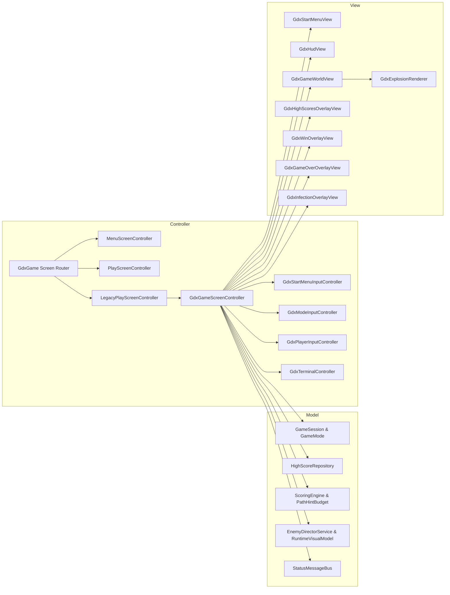

# maze-libgdx

libGDX frontend module for MazeGame. Provides a high-performance, hardware-accelerated desktop UI built on libGDX (LWJGL3 / OpenGL) with full gameplay parity with the JavaFX frontend.

## Key responsibilities

- **GdxAppLauncher** — LWJGL3 application entry point; sets window size, title, audio settings, and starts the game.
- **GdxGame** — Central screen router managing transitions between start menus, difficulty selection, and the active gameplay screen.
- **GdxGameRenderPipeline** — Multi-layered rendering engine orchestrating `SpriteBatch` and `ShapeRenderer` passes.
- **GdxGameLayoutSupport** — Dynamic window sizing, camera tracking, arena layout, and goal placement.
- **GdxEnemyRuntime** — High-level runtime opponent tracking, walk-cycle frame advancement, F80 damage-state sprite resolution, and projectile simulation.
- **GdxGuardTowerSupport** — Level 4 guard towers: feeds the shared `GuardTowerSession` (rpg every 3 s, gatling in between, shoots over up to 3 walls) the tower enemies and the player, then draws the rockets and gatling rounds, plays the sounds and starts the blasts. Towers are `GdxEnemyRuntime` enemies (`isGuardTower`) spawned by `RuntimeVisualModelLoader.guardTowerSpawns`; they leave no corpse (`GdxGameCombatAndEnemyFlowSupport.retire`).
- **GdxWallBuilderSupport** — Level 5 wall builders: feeds the shared `WallBuilderSession` the builder enemies, the live walls and the player, moves the builders where it says (converting screen y-up to world y-down) and adds the wooden walls to the world. Builders are `GdxEnemyRuntime` enemies (`isWallBuilder`, `isHarmless`: no contact damage) spawned by `RuntimeVisualModelLoader.wallBuilderSpawns`.
- **Lava (level 6)** — `GdxGameWorldView.setLava` draws the shared `LavaEffect` in its own pass between the background and the walls (the picture is flipped over the board height, the screen is y-up); `GdxWorldView.wouldCollide` keeps enemies out of deadly lava; `GdxGameScreenController.tickLava` kills the player in lava through `PlayerCombatStateService.killOutright` (the shield does not help).
- **GdxUiScheduler** — Thread-safe UI task execution bridging background worker threads and the OpenGL render loop.

---

## Architecture & MVC Screen System

`maze-libgdx` is structured according to the Model-View-Controller (MVC) pattern, separating presentation from state and input handling:



### Screen Flow & Controllers

1. **GdxGame** initializes the OpenGL context, viewport, batch, and asset managers, routing between screens.
2. **MenuScreenController**:
   - Manages the title screen, difficulty picker (`EASY`, `NORMAL`, `HARD`), and high scores overlay.
   - Preloads menu and gameplay textures into `GdxAssetService` at launch, skipping missing optional textures gracefully.
3. **PlayScreenController / GdxGameScreenController**:
   - Hosts the primary gameplay loop: input polling, physics updates, enemy director ticks, projectile tracking, and rendering.
   - Coordinates overlays for victory (`GdxWinOverlayView`), defeat (`GdxGameOverOverlayView`), and damage flash (`GdxInfectionOverlayView`).
4. **Input Controllers**:
   - `GdxPlayerInputController` maps arrow keys / WASD to directional player movement, **SPACE** to bomb placement, and **P** / **O** to path hint queries.
   - `GdxTerminalController` intercepts the **T** key to toggle the in-game command terminal (e.g. `/kill`, `/kill fire|shot|crushed`, `/h`).

---

## Rendering Pipeline (`GdxGameRenderPipeline`)

World geometry, characters, effects, and overlays are rendered in a deterministic, layer-sorted sequence every frame:

1. **Background**: Tiled terrain background matching the active difficulty setting.
2. **Walls**: Rendered via `RealMaze` adapters. Live wall states reflect destruction of breakable walls (Dirt, Wood, Glass, Steel) in real-time.
3. **Remains & Corpses**: Vanquished enemies and bloodstains drawn beneath active entities.
4. **Enemies**: Rendered with directional walk-cycle sprites, damage-state sprites, and opacity blending (e.g., phased ghosts fade according to `visibilityLevel`).
5. **Player**: Directional sprite animation with damage feedback and invulnerability flash.
6. **Projectiles**: Arcing lobs, straight shots, and beam projectiles simulated in 2D space.
7. **Explosions (`GdxExplosionRenderer`)**: Unified single-pass renderer drawing player bomb fire blasts (`FireBlastVisual`) and pumpkin bomber bursts (`PumpkinBurstVisual`). Puffs are sorted by layer:
   - Smoke puffs: Normal alpha blending (`GL_SRC_ALPHA`, `GL_ONE_MINUS_SRC_ALPHA`).
   - Fire / core puffs: Additive blending (`GL_SRC_ALPHA`, `GL_ONE`) for glowing combustion.
   - Pumpkin rind / debris: Normal alpha blending on top.
   - GL blend state is restored cleanly after the pass.
8. **Navigation Path Hints**: Overlaid path segments rendered when the player holds **P** (budgeted) or **O**.
9. **HUD**: Lives, score, remaining path hint budget, and status message bus banner.
10. **Overlays & Terminal**: In-game cheat terminal, high score tables, and end-of-game dialogs.

---

## Damage-State Sprites & Animation (F80-4)

Enemies dynamically transition between visual damage tiers as their hit points drop:

- **Damage States**: `HEALTHY` (100% HP) → `DAMAGED` (< 75% HP) → `BLEEDING` (< 50% HP) → `TIRED` (< 25% HP).
- **EnemyAnimationSpec**: Holds the `damageStatesEnabled` flag read from `opponentModel.xmi`.
- **Runtime Derivation**: `GdxEnemyRuntime.currentFramePath()` queries the shared `DamagePathResolver.resolveWithFallback()`.
  - Combines the enemy's current facing direction (`-left`, `-up`, `-right`) with its walk-cycle frame (e.g. `zombie1-left.png`).
  - Automatically resolves the damage variant (e.g. `zombie1-damaged-left.png`, `zombie1-bleeding-left.png`, `zombie1-tired-left.png`).
  - If a specific damage asset is missing on the classpath, it falls back seamlessly to the base healthy frame without throwing exceptions or logging error spam.
- **Directional Turning**: Pumpkin bombers, zombies, and ghosts dynamically turn and track towards their target, updating both healthy and damaged textures according to facing.

---

## Camera Follow (F27) & Viewport Layout

`GdxGameLayoutSupport.updateCameraFollow(viewport, maze, player, camera)` tracks player movement every frame:

| Condition | camX | camY |
|---|---|---|
| Maze fits viewport axis | `mazeSize / 2` (fixed centre) | `viewportSize / 2` (bottom-anchor) |
| Maze exceeds viewport axis | `clamp(playerPos, halfView, mazeSize − halfView)` | `clamp(playerPos, halfView, mazeSize − halfView)` |

- `computeCameraPosition(viewW, viewH, mazeW, mazeH, px, py)` is a pure-math helper used by both runtime rendering and headless unit tests (`GdxCameraFollowTest`).
- `resizeWindowForDifficulty(difficulty)` scales the window to board bounds while ensuring dimensions never exceed display monitor limits.

---

## Thread Safety & UI Scheduling

- **GdxUiScheduler**: Manages thread switching between background workers (such as timers, pathfinding, or model services) and the OpenGL thread:
  - Calls originating on the OpenGL render thread execute inline immediately.
  - Calls originating on worker threads are posted via `Gdx.app.postRunnable` to ensure safe GL context access.
- **Wall Damage Concurrency**: `GdxWallDamageSupport` queues bomb blast wall hits from worker threads and applies destructions safely on the render thread, preventing concurrent modification exceptions while mutating `GameMazeWorld`.

---

## Building & Running

### From CLI using PowerShell Helper (Recommended)
```powershell
# Prepare launch environment and run
.\make-libgdx.ps1 -Target run

# Fast build (no clean)
.\make-libgdx.ps1 -Target quick

# Full clean verify
.\make-libgdx.ps1 -Target build
```

### From Visual Studio Code
1. Open the **Run and Debug** side bar (`Ctrl+Shift+D`).
2. Select **Launch MazeGame (libGDX backend)**.
3. Press **Ctrl+F5** to run or **F5** to debug.

### Direct Maven Build
```bash
# Build module and dependencies
mvn clean package -pl maze-libgdx -am

# Run tests
mvn test -pl maze-libgdx
```

---

## Weapons, pickups and kill credit

- `GdxWeaponSupport` — spawns and collects pickups (`PickupField`, spawn points clear of walls from `PickupField.spawnPointsOf`), fires the laser (`LaserBeamEngine`), swings
  the sledgehammer (`MortalityService.strikeAround`), ticks combat effects and the weapon drawn in the player's hands.
- `GameWorldModel` owns the per-game `PickupField`, `PlayerArsenal`, `PowerShield`, `KillLedger` and active effects.
- `PlayerCombatStateService.setShield(...)` blocks damage while the shield is up; `heal(...)` applies hearts, and
  `GdxWeaponSupport.healFlash` / `healArrow` show the flash and the rising arrow over the player (`HealFeedback`).
- `GdxGameCombatAndEnemyFlowSupport.processKilledEnemies(..., KillLedger)` credits each kill to its killer;
  `EnemySpawn.killPoints` comes from `KillScoring` (the enemy's danger). The HUD shows the arsenal (`ArsenalHud`).
- Tab is bound to `SwitchWeaponCommand`; Space or a right click uses the weapon in hand; movement keys come from
  `GdxMovementKeys` (arrows, numpad, Q/A, W, E, S/D).
- `GdxHudView` draws the weapons HUD (top-left) from the shared `WeaponHud` model.
- Lives: `GameWorldModel.lives()`; the death sequence asks `GdxGameScreenController.respawnPlayer()` first, which
  puts the player back at the start (`PlayerState.teleportTo`) with full health and spawn protection while lives are left.

## Test Suite Documentation

Unit tests in `maze-libgdx` verify rendering logic, physics, entity lifecycles, and backend parity without requiring an active graphical display:

- **GdxBackendTest**: Validates `GdxUiScheduler` inline execution on the render thread and `Gdx.app.postRunnable` delegation from worker threads.
- **GdxExplosionRendererTest**: Validates single-pass multi-layer rendering of fire blasts and pumpkin bursts, layer sorting, and GL blend mode restoration.
- **GdxEnemyRuntimeAnimationTest**: Tests walk-cycle derivation, damage-state sprite switching across all 4 tiers, direction-facing resolution, and healthy-sprite fallback.
- **RuntimeVisualModelLoaderTest**: Verifies that every enemy configured in the shipped `opponentModel.xmi` has damage states enabled and that all derived sprite files exist on disk.
- **GdxEnemyRuntimeProjectileTest**: Verifies F26 projectile speeds, LOB ballistic arcs (`distance = speed × time`), straight-shot wall collision, and splash-radius damage triggers.
- **EnemyRemainsFlowTest**: Enemies killed by fire / shot / crushed leave coal / bloody / splat remains where they died (none for plain `/kill`); remains vanish when that enemy respawns; a collapsing wall falls as `WallRubbleVisual` rubble (y-down converted to y-up) and crushes the enemy beside it but not one further away; rubble expires after its lifetime.
- **GdxWallDamageThreadSafetyTest**: Tests thread-safe deferral of wall hits to the render thread and ensures duplicate queued hits damage walls exactly once.
- **GhostTangibilityParityTest**: Verifies F25 ghost phasing mechanics, `visibilityLevel` capping, and cross-frontend opacity parity with JavaFX `GhostNonTangibilityService`.
- **SampleMazeTest & RealMazeTest**: Validates deterministic maze generation, axis-aligned walls, and dynamic synchronization with breakable wall state.
- **PlayerStateTest & GdxCameraFollowTest**: Headless validation of player border clamping, goal proximity detection, and camera follow math.
